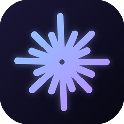

<h1 align="center">Visync</h1>

<b>Small apps, made with care.</b> Free to download · Not open source

<a href="https://github.com/visync-apps/downloads"><b>Download our apps</b></a> &nbsp;·&nbsp; <a href="https://visync.2mnhdbfn5n.workers.dev">Website</a> &nbsp;·&nbsp; <a href="https://sounddrop.samour.ca/donate">Donate</a>

| App | What it does |
|:--|:--|
| **[SoundDrop](https://sounddrop.samour.ca)** | Sound effects for your videos |
| **[Quillwave](https://github.com/visync-apps/downloads/releases/tag/quillwave-4.6)** | A music player in your menu bar |
| **[Glow](https://github.com/visync-apps/downloads/releases/tag/glow-2026.0.1)** | Your Philips Hue lights, from the menu bar |
| **[Fetch](https://github.com/visync-apps/downloads/releases/tag/fetch-2026.0.1)** | Save video or audio from links you choose |
| **[Shelf Setup](https://github.com/visync-apps/downloads/releases/tag/shelf-setup-2026.0.1)** | Turn a USB drive into a drive of apps |
